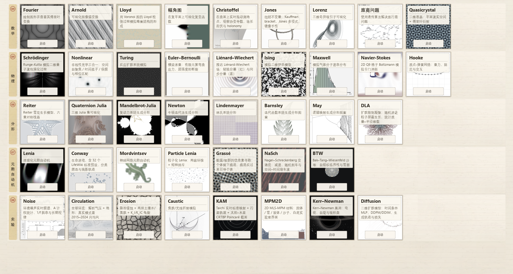

# PySide 可视化工具箱

> 41 个可独立运行的数学、物理、分形与元胞自动机可视化应用。  
> PySide6 + Taichi + OpenGL，Windows 桌面优先。

[](https://github.com/Y-jx007/PySide-demo-collection/actions/workflows/ci.yml)
[](https://github.com/Y-jx007/PySide-demo-collection/releases/latest)
[](LICENSE)



## 这是什么

一个“应用画廊”式的桌面工具集：启动器按分类陈列 41 个应用，每个应用在**独立子进程**中运行，互不影响 Taichi / OpenGL / PyTorch 运行时。应用覆盖复分析、动力系统、分形、流体、光学、相对论、元胞自动机等主题，全部带实时参数调节和可保存画面。

- **41 个应用**，5 个分类：数学 9、物理 9、分形 8、元胞自动机 7、实验 8
- **统一启动器**：缩略图、分类滑动、拖拽排序、就绪/崩溃状态、运行日志
- **GPU 加速**：Taichi 内核、OpenGL 画布、Numba JIT、可选 PyTorch
- **可复现**：397 个测试 + 41 应用窗口 smoke；CI 使用 Python 3.14

## 下载与安装

### Windows 安装器（推荐）

从 [Releases](https://github.com/Y-jx007/PySide-demo-collection/releases/latest) 下载
`PySideToolbox-Setup.exe`。

安装器会：

- 复制应用与资源；
- 用系统 Python 创建独立 `.venv`；
- 安装核心依赖（`PySide6-Essentials`、NumPy、Taichi Forge、Numba、SciPy、Matplotlib 等）；
- **PyTorch 可选**：不安装 / pip 默认 / CPU / CUDA 12.4；
- 生成 `启动.bat`、`诊断启动.bat`、`卸载.bat`，可选桌面快捷方式。

> 安装器本身约 86 MB，不要求预装 PySide6/Taichi；但要求系统已有
> **Python 3.10+（推荐 3.14）**。没有 PyTorch 时，Diffusion 和 Mordvintsev
> 不可用；Nonlinear 会自动回退 NumPy。

安装器源码和构建说明见 [installer/README.md](installer/README.md)。

### 从源码运行

```bash
git clone https://github.com/Y-jx007/PySide-demo-collection.git
cd PySide-demo-collection

py -3.14 -m venv .venv
.venv\Scripts\activate
python -m pip install -r requirements.txt

# 可选：Diffusion / Mordvintsev / Nonlinear GPU
python -m pip install -r requirements-distill.txt

python main.py
```

单独运行一个应用：

```bash
python app_runner.py "apps/Fractals/Mandelbrot.py"
```

## 启动器

- 左键拖动分类条可横向滑动；右键拖动卡片可调整顺序或分类。
- 跨分类拖动会移动 `apps/<分类>/` 下的源文件，并同步改写 `apps_manifest.py`。
- 卡片布局保存在 `runtime/launcher_layout.json`（已加入 `.gitignore`）。
- 子进程就绪后写 `runtime/ready/` 标记；日志追加写入 `runtime/logs/`，超过 2 MB 轮转一次。
- 单个应用崩溃只影响该子进程，启动器会显示错误并提供日志入口。

## 应用目录

完整路径、依赖和封面见 [docs/APP_MATRIX.md](docs/APP_MATRIX.md)。

<details>
<summary><b>数学 · 9</b></summary>

| 应用 | 内容 |
|---|---|
| **Fourier** | 绘制图形并查看二维傅里叶变换 |
| **Arnold** | Arnold 猫映射（离散混沌） |
| **Lloyd** | Voronoi 图的 Lloyd 松弛 |
| **幅角图** | 复变函数域着色，基于 [cplot](https://github.com/nschloe/cplot) |
| **旅商问题** | 遗传算法求解 TSP |
| **Lorenz** | 三维洛伦兹吸引子 |
| **Christoffel** | 曲面上的联络、协变导数与 holonomy |
| **Jones** | 扭结不变量、Kauffman bracket、Jones 多项式 |
| **Quasicrystal** | 二维准晶：平面波 + 傅里叶衍射 |

</details>

<details>
<summary><b>物理 · 9</b></summary>

| 应用 | 内容 |
|---|---|
| **Nonlinear** | 非线性光学：空间自聚焦、时间孤子、倍频/和频/差频、四波混频 |
| **Schrödinger** | 二维量子波包演化（RK4） |
| **Turing** | Gray–Scott 反应扩散 |
| **Euler–Bernoulli** | 悬臂梁有限元，超材料强度即断裂 |
| **Liénard–Wiechert** | 变速圆周电荷的真实推迟辐射场 |
| **Ising** | 二维伊辛模型 |
| **Maxwell** | 二维麦克斯韦–玻尔兹曼速率分布 |
| **Navier–Stokes** | 2D Q9 格子 Boltzmann 模拟 |
| **Hooke** | 质点–弹簧网络与四种预设 |

</details>

<details>
<summary><b>分形 · 8</b></summary>

| 应用 | 内容 |
|---|---|
| **Reiter** | 六重对称雪花生长模型 |
| **Quaternion Julia** | 三维四元数 Julia 集 |
| **Mandelbrot–Julia** | 双画布 Mandelbrot / Julia |
| **Newton** | Newton / Nova 分形 |
| **Lindenmayer** | L-System 分形 |
| **Barnsley** | 迭代函数系统 |
| **May** | Lyapunov 分形与分叉图 |
| **DLA** | 扩散限制凝聚 |

</details>

<details>
<summary><b>元胞自动机 · 7</b></summary>

| 应用 | 内容 |
|---|---|
| **Grassé** | 间接通信（stigmergy）：黏菌网络与蚁群觅食 |
| **Lenia** | 连续元胞自动机，含 340+ 预设 |
| **Conway** | 生命游戏，LifeWiki 标准预设 |
| **Mordvintsev** | 神经网络元胞自动机（需要 PyTorch） |
| **NaSch** | Nagel–Schreckenberg 交通流 |
| **BTW** | Bak–Tang–Wiesenfeld 沙堆 |
| **Particle Lenia** | 粒子化 Lenia |

</details>

<details>
<summary><b>实验 · 8</b></summary>

| 应用 | 内容 |
|---|---|
| **Noise** | 环境噪声实时统计（需要 sounddevice） |
| **Kerr–Newman** | 带电旋转黑洞光线追踪 |
| **Circulation** | 全球环流：合成气压 + 真实再分析风场 |
| **Erosion** | 土壤水与 Voronoi CZM 干裂 |
| **Caustic** | 焦散/光线折射 |
| **MPM2D** | 2D MLS-MPM 材料演示：弹性、雪、水、沙 |
| **KAM** | 标准映射频率图、行星轨道、CRTBP Poincaré 截面 |
| **Diffusion** | 二维扩散模型（需要 PyTorch） |

</details>

## 设计

### 进程隔离

启动器为每个应用启动独立子进程。这样 Taichi 的 GPU 运行时、OpenGL 上下文、
PyTorch CUDA 上下文不会互相重置；应用崩溃也不会拖垮启动器。

### 单一应用清单

`apps_manifest.py` 是应用标题、描述、分类、路径和可选依赖的唯一来源。
启动器、`docs/APP_MATRIX.md`、测试都从这份清单读取。

### 就绪与日志

- 子进程启动后写 `runtime/ready/<pid>`；启动器按 pid 判断是否就绪，不再固定等待 6 秒。
- stdout/stderr 写入 `runtime/logs/`，2 MB 轮转；崩溃对话框可直接打开日志。
- 首次启动 Taichi/Numba 编译较慢时，启动器显示“正在启动”，不会误判为失败。

### 公共层

`common/` 提供 Qt 画布、滑块、图像转换、matplotlib 画布、Taichi/Numba/OpenGL
初始化、worker 线程和统一窗口模板；`support/` 放各应用的数值内核和数据访问代码。
应用入口只保留界面与交互。

```text
main.py                启动器：画廊 + 子进程管理
app_runner.py          单应用入口（配置 sys.path / cwd）
apps_manifest.py       应用清单
apps/<分类>/<应用>.py   41 个应用入口
common/                共享 Qt / 数值 / 画布 / 运行时封装
support/               应用专用数值模块与数据读取
assets/                缩略图、数据、模型、QSS、图标
runtime/               日志、就绪标记、布局、Numba 缓存（不入库）
tools/                 数据重建、UI 检查、注册表同步、应用骨架
tests/                 单元 / 导入 / manifest / 窗口 smoke
installer/             自定义 Windows 安装器
docs/                  应用矩阵、UI 规范、技术札记
```

## 开发

### 测试

```bash
python -m unittest discover -s tests -v
```

当前为 **397 tests**。按环境变量启用窗口级 smoke：

```bash
# 本地/有 GPU：完整 41 个应用窗口
set RUN_WINDOW_SMOKE=1
python -m unittest tests.test_all_app_windows -v

# CI/无 GPU：只测不依赖 GL/CUDA 的应用
set RUN_WINDOW_SMOKE=cpu
python -m unittest tests.test_all_app_windows -v
```

完整 smoke 使用 2 个并发 worker，并对偶发 GL 崩溃重试一次。

### UI 与应用骨架

```bash
python tools/check_ui_style.py "apps/Math/Quasicrystal.py"
python tools/new_app.py Math/Matrix --title Matrix --description "2x2 线性变换"
python tools/sync_registry.py --check
```

新应用必须遵循 [docs/UI_GUIDELINES.md](docs/UI_GUIDELINES.md)。生成骨架会写出
入口、清单条目和封面；随后替换占位绘制并补测试。

### CI

[`.github/workflows/ci.yml`](.github/workflows/ci.yml) 在每次 push 上运行：

1. **syntax + registry**：Python 3.14 编译检查、manifest 同步检查；
2. **Windows tests**：安装依赖，跑 UI 检查、397 tests 和 CPU smoke；
3. **installer**：构建 `PySideToolbox-Setup.exe` 并上传 artifact。

推送 `v*` 标签会触发 [`.github/workflows/release.yml`](.github/workflows/release.yml)，
把安装器上传到 GitHub Release。

### 构建安装器

```bash
python -m pip install pyinstaller
python installer/build_setup.py
```

## 性能说明

- **Nonlinear**：空间模式 640²，torch CUDA 常驻 FFT；启动时预热，避免切换卡顿。没有 torch 时回退 NumPy + 192²。
- **MPM2D**：32 子步上限、GPU 软粒子 splat 渲染；渲染层不参与物理。
- **Navier–Stokes**：800×250 LBM；kernel 合并和 ndarray graph 实测均无收益，保留原实现。
- 所有应用保持全速运行，不做 FPS 限帧或低功耗降级。

更细的测量与尝试记录见 [性能排查](docs/PERFORMANCE.md) 和 [技术札记](docs/TECHNICAL_NOTES.md)。

## 已知限制

- Windows 优先；需要 OpenGL 的应用在无 GPU 的 CI 中只做跳过处理。
- **实验**分类不承诺与其他分类相同的完善度，可能依赖额外数据、设备或 torch。
- 分形拖动时先出 1x 预览，停手 180 ms 后按所选 AA 精修；4x 高迭代仍可能有一次短暂停顿。
- 分形使用 f64 直接迭代，缩放约 10¹⁴ 后到达浮点精度极限，继续放大只会变成色块。Mandelbrot 的“深度缩放…”按钮提供 Decimal 任意精度 CPU 渲染，可越过这个限制，但速度明显慢于 GPU 画布。
- `eval` / `exec` 用于用户自定义表达式，仅应输入本地可信内容，不构成安全沙箱。
- 安装器不打包 Python 解释器，要求系统已有 Python 3.10+。

## 文档

- [应用矩阵](docs/APP_MATRIX.md)
- [UI 规范](docs/UI_GUIDELINES.md)
- [技术札记](docs/TECHNICAL_NOTES.md)
- [性能排查](docs/PERFORMANCE.md)
- [安装器说明](installer/README.md)
- [第三方许可](THIRD_PARTY_NOTICES.md)

## License

MIT，见 [LICENSE](LICENSE)。
